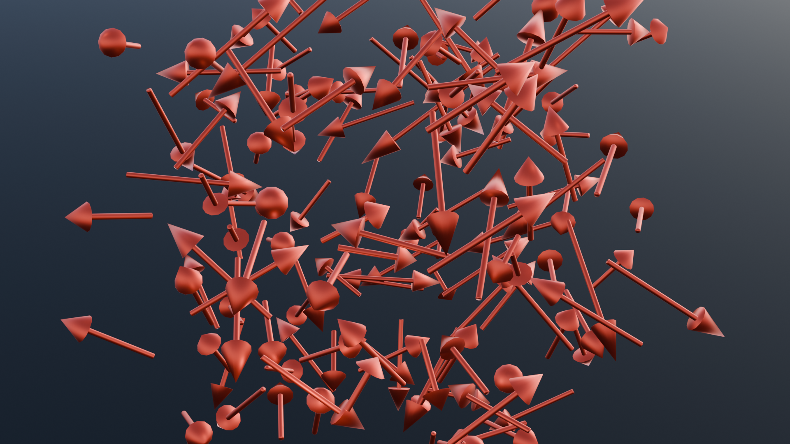
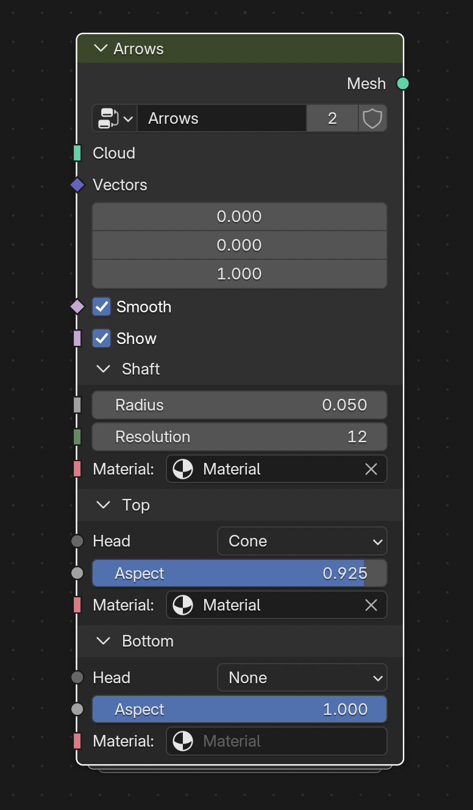
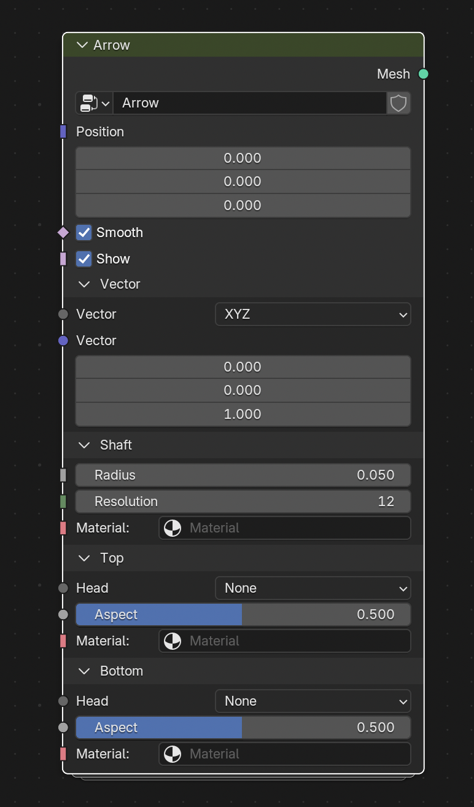

# arrows demo

This page describes a demonstration scene. For current tree declarations and
build calls, see [Modifiers, groups and tools](../getting_started/modifiers_groups.md)
and [Packages](../getting_started/packages.md). Older module-level `demo(...)`
entry points are specific to each demo and do not define the builder API.

This demo builds two modifiers:

- arrow : create a single arrow with control of position, orientation, length, size
- arrows (field of arrows) : one arrow on each geometry point

## arrows modifier

## arrow modifier

## What to learn

- using closure for various arrow head shapes
- using menu to select different geometries

