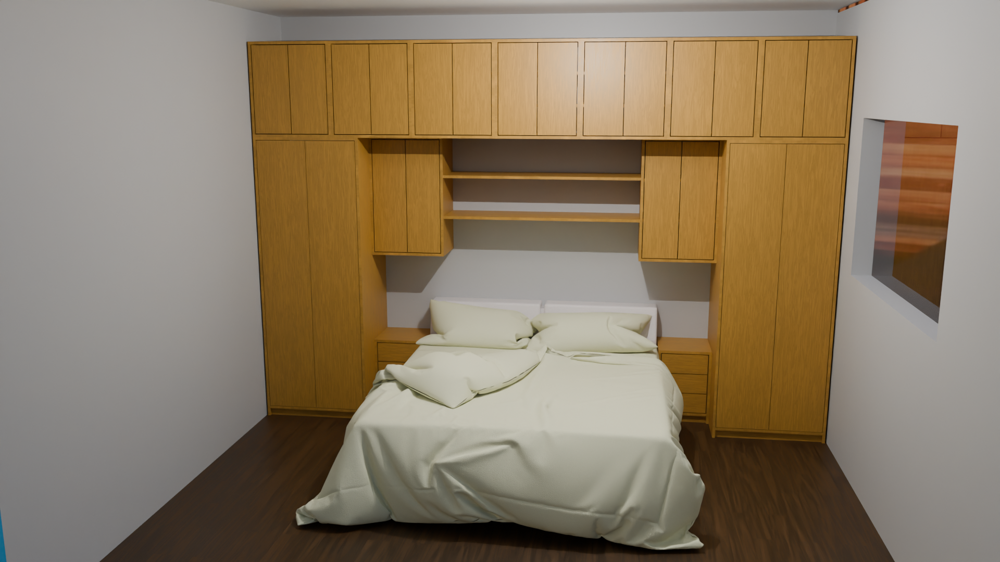

# Furniture



This demo builds furniture by arranging **blocks**, then placing boards on those
blocks. A block describes a reference volume: its position, dimensions, and
construction boundaries. Resources, named parameters, and block properties are
stored in the geometry Bundle throughout the modifier stack.

To create the node groups and modifiers:

```python
from geonodes.demos import furniture

furniture.demo()
```

After updating the demo, use `furniture.demo(rebuild=True)` to rebuild existing
groups.

## Conventions

Coordinates use the furniture object's local reference frame:

| Axis | Dimension |
| --- | --- |
| X | Depth |
| Y | Width |
| Z | Height |

The origin `(0, 0, 0)` is the lower left corner of the cabinet, at the back.
The front faces increasing X, the right faces increasing Y, and the top faces
increasing Z.

## Resources and global parameters

The first modifiers define the resources and names used to build the furniture.

**Define Resource** defines a board resource: its name, dimensions, thickness,
Blender material, and color. Construction modifiers select their boards from
these resources. **Define Plinth** specifies the plinth resource, height, and
setbacks.

**Capture Resources** retrieves resources from another object. This lets you
centralize their definition in a reference object and share them across several
cabinets. To create a material or thickness variant, change the reference
resources without rebuilding the block layout.

**Define Named Dimensions** defines named values used as global parameters:
module width, cabinet height, clearance, and so on. Later modifiers can refer to
these names instead of repeating numeric values.

## Arranging blocks

**Define Block** creates an empty block. It adds no boards; enable `Show Frame`
to display its reference volume.

Position and dimension fields offer several value sources:

- **Value**: a value entered directly in `Offset`.
- **Name**: a named global parameter, with an optional offset.
- **Block**: a property of an existing block, with an optional offset.

A block reference can use its width, top, right edge, center, and other
properties. The boundary selection lets you work with reference, inner, or outer
dimensions. Dimension fields also offer `Dimension` and `Target` modes: enter
either a size or the coordinate to reach.

For example, to place a module to the right of another, reference the latter's
`Right` edge for the Y position. To align their tops, use its `Top` property as
the Z target. The referenced block must be defined earlier in the modifier stack.

## Adding boards

Once a block is defined, the following modifiers select it by name:

| Modifier | Elements built |
| --- | --- |
| **Add Box** | Left and right sides, top, bottom, and plinth, depending on the options |
| **Add Face** | Doors or drawer fronts, depending on `Type` |
| **Add Shelves** | Horizontal shelves |
| **Add Separators** | Vertical dividers |

**Add Block** combines these steps: it creates the block and lets you build its
carcass, shelves, dividers, and front directly. You can therefore start with an
empty block or create a block already fitted with boards.

Grain orientation affects the UV coordinates and the width/length order in the
cut sheet. It does not change the board geometry: `Normal` keeps the original
direction, while `Rotate` turns the grain by 90°. The material must use `UV Map`
to display this choice.

## Dividing and duplicating

**Divide Block** creates sub-blocks using a vertical or horizontal division.
`Count` sets the number of parts. With `Even` enabled, their inner dimensions are
equal, accounting for the divider boards; otherwise, the `Size` fields specify
the successive dimensions. The `Plank` field selects the divider resource; leave
the name empty to skip building the dividers.

**Duplicate Block** creates a copy of a block. Enable `Planks` to copy its boards
as well. Copies can be placed:

- by translation, using `Offset Y` and `Offset Z`;
- by symmetry along Y or Z, around the selected center;
- as an array, using `Count` when `Symmetry` is set to `No`.

In an array, each copy starts from the source block. The displacement is one
offset for the first copy, two offsets for the second, and so on. The source
block remains present. Symmetry mode creates a single copy.

### Block names

**Every block must have a unique name**, including blocks created by division
or duplication.

- Division combines the parent block name, `Name Suffix`, and an index starting
  at zero: for example, `Module Part 0`, `Module Part 1`.
- Duplication uses `New Name`.
- Array duplication appends an index: with `New Name = Module`, copies are named
  `Module 0`, `Module 1`, and so on.

The **Cut Sheet** modifier displays block names in a column to the right of the
resource list. Use this list to find the names to enter in later modifiers.

## Animating doors and drawers

**Open Door** simulates opening a door using an angle, axis, and pivot side.
**Open Drawer** moves a drawer front and adds a simplified drawer box to
visualize the opening.

Selection uses the block, role, and index. These modifiers can prepare a still
view or animate opening parameters in Blender. The drawer box is a simplified
visual representation; its panels are not added to the cut sheet.

## Dimensions and derived views

**Add Cotes** displays a block's dimensions and, optionally, its positions along
X, Y, and Z. Its options control text size, line thickness, and dimension
placement.

**Delete Plank** removes boards from the displayed geometry to make dimensions
easier to read: for example, remove doors to show the cabinet interior.
Construction metadata and cut sheet entries are preserved.

**Capture Furniture** lets you prepare these views on a separate object using
a reference cabinet. The `Source` selector retrieves either an object with
`Object` or connected geometry with `Geometry`. Both the geometry and its Bundle
are passed to subsequent modifiers.

For example, a presentation stack can be:

```text
Capture Furniture
→ Delete Plank
→ Add Cotes
```

Another view can use `Capture Furniture` followed by `Open Door` or `Open Drawer`.
These objects follow the reference cabinet while keeping their own presentation
settings.

## Generating the cut sheet

1. Build the furniture and define its board resources.
2. Create a separate object for the cut sheet and add the **Cut Sheet** modifier.
3. In the `Furniture` field, select the reference furniture object.
4. The resulting geometry displays resource IDs and names, with block names on
   the right. It also contains the cut data as a point cloud.
5. In Blender's Python console, call `get_cut_sheet` with the name of **the object
   carrying the Cut Sheet modifier**:

```python
from geonodes.demos import furniture

print(furniture.get_cut_sheet("Furniture Cuts"))
```

Replace `Furniture Cuts` with that object's name. The result groups pieces with
the same resource, dimensions, and orientation, adding their quantities.
Dimensions are expressed in millimeters. The text displays each resource ID,
followed by lines formatted as `length x width (orientation) : quantity`.

To retrieve the data as JSON:

```python
cuts_json = furniture.get_cut_sheet("Furniture Cuts", json=True)
print(cuts_json)
```

Each entry contains `res_id`, `count`, `size`, and `orient`. The `size` field
contains width, length, and thickness in millimeters; `orient` is `0` for `Normal`
and `1` for `Rotate`. Cut sheet width and length are already swapped when the
grain is rotated.
