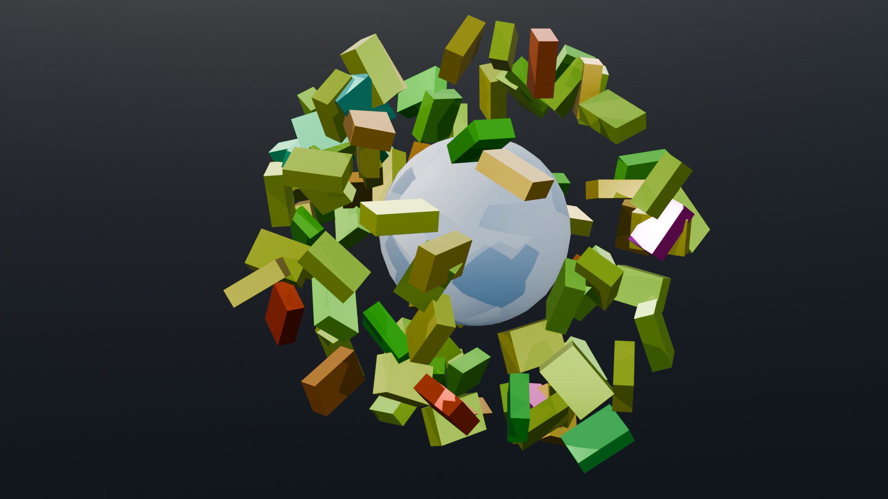

# random demo

This page describes a demonstration scene. For current tree declarations and
build calls, see [Modifiers, groups and tools](../getting_started/modifiers_groups.md)
and [Packages](../getting_started/packages.md). Older module-level `demo(...)`
entry points are specific to each demo and do not define the builder API.

All the random generators provide a _Single_ output socket which can be used on a single value
input socket.

## Modifiers

- **Random Uniform Value** : equivalent to standard node plus a _Single_ output socket
- **Random Uniform Vector** : equivalent to standard node plus a _Single_ output socket
- **Random Normal Value** : random value on a normal distribution
- **Random Normal Vector** : random direction with a random normal length 
- **Random Rotation** : random axis with a random normal rotation angle

