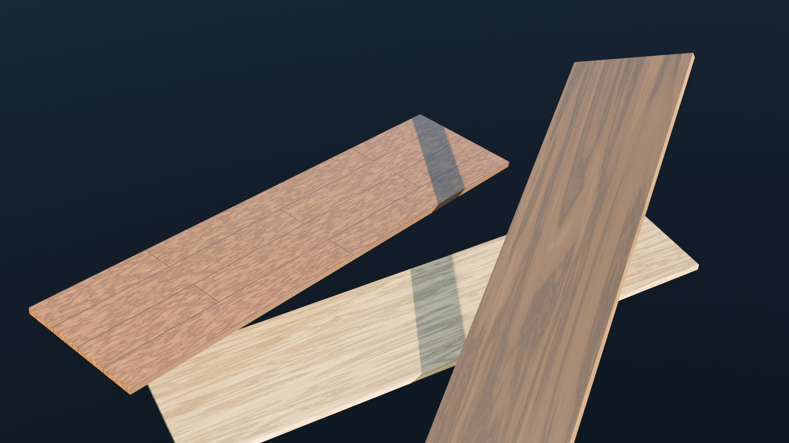
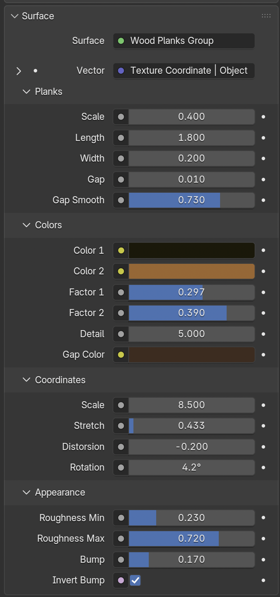

# shaders demo

This page describes a demonstration scene. For current tree declarations and
build calls, see [Modifiers, groups and tools](../getting_started/modifiers_groups.md)
and [Packages](../getting_started/packages.md). Older module-level `demo(...)`
entry points are specific to each demo and do not define the builder API.

Simple wood materials

## Materials

- **Wood** : Wood material
- **Wood Planks** : Planks of wood material

## What to learn

- Creating shaders

