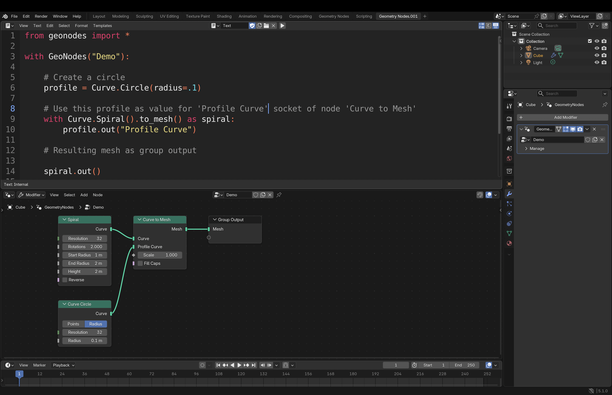

# Linking sockets

Linking a socket is as simple as setting a python value. Here after are the ways to link to nodes:

- Outing to the _Group Output_ node
- Passing argument to a class method
- Explicitly setting a node input socket

Decorated builders use the same linking operations. Function parameters provide
input sockets and `.out()` declares outputs; returning a Python value does not
create a Group Output socket. See [Modifiers, groups and tools](modifiers_groups.md).
For material output routing, see [Shaders](shaders.md#material-output-inputs).

## Group outputs

Any instance can be outed to the _Group Output_ node with the methode `out`:

``` python
@modifier('Outing to Group Output')
def outing_to_group_output():

    # Getting the group input geometry
    geo = Geometry()

    # Outing
    geo.out()

    # Outing with a name
    geo.transform(scale=2).out("Scaled by Two Geometry")

outing_to_group_output.build()
```

## Method argument

The standard syntax to provide values to input sockets of a node, is to use
argument of a function:

``` python
    # Create a circle : input socket radius is initialized to 0.1
    profile = Curve.Circle(radius=.1)

    # Use this profile as value for 'Profile Curve' socket of node 'Curve to Mesh'
    spiral = Curve.Spiral().to_mesh(profile_curve=profile)

    # Resulting mesh as group output
    spiral.out()
```

## Replacing Group Output

Another way to set values to input socket is to temporarily set the node as current
output node, replacing the the Group Output Node. This is done using the ***with*** context
as shown below.

``` python
    # Create a circle
    profile = Curve.Circle(radius=.1)

    # Use this profile as value for 'Profile Curve' socket of node 'Curve to Mesh'
    with Curve.Spiral().to_mesh() as spiral:
        profile.out("Profile Curve")

    # Resulting mesh as group output
    spiral.out()
```



For dynamic input nodes, the node context directs `.out()` to that node instead
of the tree output. The same rule applies inside a decorated builder. Use the
current signatures in the [API reference](../api/index.md) for Menu Switch and
Index Switch; function arguments bind the inputs of a called group.

## Setting node sockets

Ultimately you can directly set input sockets of a node as shown below:

```python
from geonodes import *

@modifier("Setting Node Input Sockets")
def setting_node_inputs():

    geo = Geometry()

    # Calling transform will create the node "Transform Geometry"
    # We can get the node from node property
    node = geo.transform().node

    # We can set the node with python values or geonodes classes
    node.translation = (1, 2, 3)
    node.scale = Vector((2, 3, 4))
    node.rotation = Rotation(name="Rotation")

    node.out()

setting_node_inputs.build()
```


