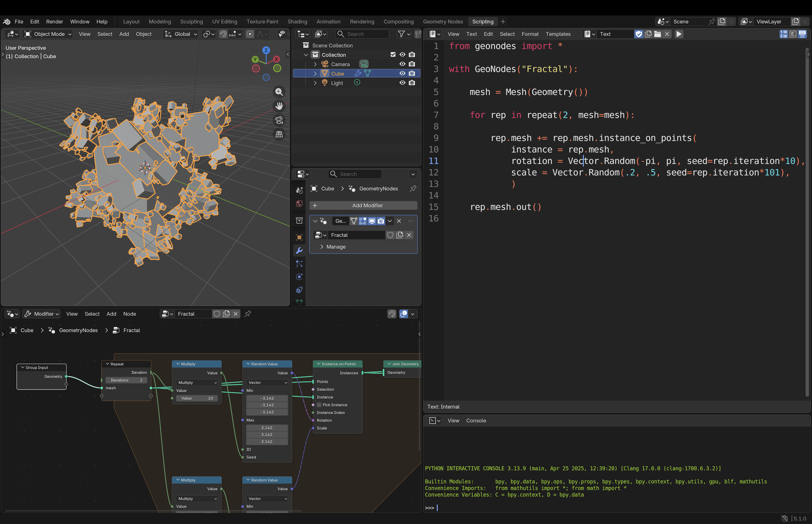

# Scripting nodes overview

All nodes belong to a tree. Two tree types are available:
- [Geometry Nodes](modifiers_groups.md), declared with `@modifier()`, `@group()` or `@tool()`
- [Shader Nodes](shaders.md), declared with `@shader()` or `@shader_group()`

!!! note
    To get the maximum benefit of **geonodes**, you must be familiar with both **python** and Blender **Geometry Nodes**.

## How it works

Each _Geometry Nodes_ output socket is wrapped by a class:

- A **Float** instance keeps a reference to an output socket of type _VALUE_
- A **Geometry** instance keeps a reference to an output socket of type _GEOMETRY_

_Geometry Nodes_ are methods, functions or operators working on the **GeoNodes** classes.
The arguments of a method are connected to the _input sockets_ of the node.
The method returns a class refering to one of its output socket, or, rarely, to the node itself.

``` python
from geonodes import *

@modifier('Socket Init')
def socket_init():

    # Get the Group Input geometry
    geometry = Geometry()

    # Plug the geometry to the Group output node
    geometry.out()

    # Create sockets from their node primitives
    with Layout("Primitives"):
        i = Integer(123)
        f = Float(3.14)
        s = String("A string")
        b = Boolean(True)
        v = Vector((1, 2, 3))
        red = Color("Red")
        green = Color("#00FF00")
        blue = Color((0, 0, 1))
        r = Rotation((pi, pi, pi/2))

    # The key word argument name indicates the following are Group input sockets
    # The value is the default value
    i = Integer(123, name = "Integer")
    f = Float(3.14, name = "Float")
    s = String("A string", name = "String")
    b = Boolean(True, name = "Boolean")
    v = Vector((1, 2, 3), name = "Vector")
    red = Color("Red", name = "Color 0")
    green = Color("#00FF00", name = "Color 1")
    blue = Color((0, 0, 1), name = "Color 2")
    r = Rotation((pi, pi, pi/2), name = "Rotation")

    # If the initial value is a string, the value is a named attribute
    # Named Attribute 'Integer'
    with Layout("Named Attributes"):
        i = Integer("Integer")
        # Named Attribute 'Float'
        f = Float("Float")

    # Creating Geometries
    with Layout("Creating geometries"):
        cube = Mesh.Cube()
        curve = Curve.Spiral()

socket_init.build()
```

## Blender Setup

Create a new script in _Scripting_ tab in **Blender**. You can setup this tab in order to display:

- A _Text editor_ for python scripting
- A _3D Viewport_ to view the progress
- A _Python Console_ to dump variables
- A _Geometry Node Editor_ to view the generated nodes

Here after is an example of the recommanded setup:



## 'Do Nothing' Modifier

Copy / paste the following piece of code to check that everything is properly setup:

``` python
from geonodes import *

@modifier('Do Nothing')
def do_nothing():
    Geometry().out()

do_nothing.build()
```

A Geometry Nodes modifier has been created with the name "Do Nothing". You can use it on any object.

## Tutorial execution model

Examples import the public API with `from geonodes import *`. Nodes are created
while a decorated builder runs. Declare the builder, then call `.build()`:

```python
from geonodes import *

@modifier("Tutorial")
def tutorial():
    Mesh.Cube().out()

tutorial.build()
```

A decorated declaration waits for construction; `.build()` creates or rebuilds
the selected tree. The generated tree can then be selected in Blender. Reusable
groups are called inside other builders; use `.build(full=True)` to also refresh
their existing dependencies.

Some focused examples show only a function body. Put these fragments inside a
builder. Explicit `with GeoNodes(...)` and `with ShaderNodes(...)` contexts are
still supported and execute immediately.

Next: [Modifiers, groups and tools](modifiers_groups.md),
[Packages](packages.md), and [Creating Sockets](creating_sockets.md).
