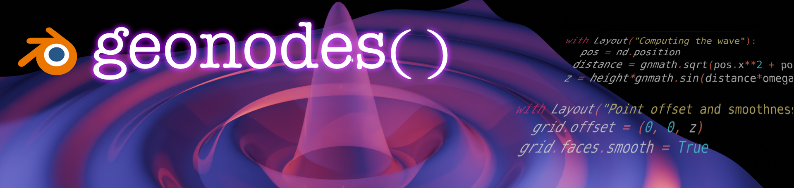

> Scripting Blender **Geometry Nodes**

**geonodes** is a Python API for creating and manipulating **Blender Geometry Nodes** programmatically.

It provides a clean, expressive DSL that lets you build node graphs using Python, instead of the Blender UI.

---

- [Overview](getting_started/overview.md)
- [Installation](getting_started/installation.md)
- [API reference](api/index.md)

---

## ✨ Features

- Pythonic API for Geometry Nodes

    - Object oriented API

        - Sockets are classes
        - Nodes are methodds and propetries

    - Full node tree construction via code
    - Designed for readability and composability

- Support for:

  - Geometry Nodes and Shaders
  - Modidiers, Groups and Tools
  - Panels to build clean user interface
  - Layouts to group and comment your trees


## Declare, build and reuse

```python
from geonodes import *

@group()
def cube(size: Vector = (1, 1, 1)):
    Mesh.Cube(size=size).out()

@modifier()
def my_modifier():
    cube(size=(1, 2, 3)).out()

my_modifier.build(full=True)
```

Decorators declare trees; `.build()` constructs them. Calling a decorated group
inside a builder inserts a Group node. Function parameters become input sockets,
and `.out()` declares outputs. Use a `Package` to organize and build a collection.

- [Modifiers, groups and tools](getting_started/modifiers_groups.md)
- [Packages](getting_started/packages.md)
- [Migration from explicit tree contexts](getting_started/migration.md)
- [Materials, volumes and targets](getting_started/shaders.md)

Blender 5.3 loads `core_5_3`, Blender 5.4 loads `core_5_4`, and so on.
Each major/minor release has its own API package; patch releases share that
package. A missing package raises an error, with no fallback to another version.
